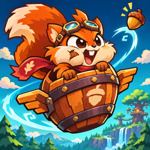

<p align="center"></p>

# Barrelwing: The Great Sky Heist

A squirrel. A stolen sky. An unreasonable number of barrels.

Barrelwing is a pixel-art action platformer about Pip, a forest courier chasing the Storm Baron and a stolen set of Sky Seeds. Run across the canopy, climb barrel-filled towers, and flap through wind channels before taking on the Baron above the clouds.

Play in a WebGL browser or install the offline Android app directly on a personal device. No account, server, ads, analytics, or network connection is required to play the installed app.

This is a playable development build. Route playtesting, balance, and device polish are ongoing; see the [quality priorities](docs/QUALITY.md) and [validation evidence](docs/VALIDATION.md).

## The game

- Nine campaign stages across Verdant Canopy, the Copperworks, and the Storm Above.
- Six post-campaign Sky Trials, including a tougher Baron rematch.
- Sky Sprint: an endless flight mode with a saved personal best, unlocked after Cloudvine Drift.
- Running, variable-height jumps, air flaps, buffered jumps, coyote time, ladders, drop-through platforms, and a barrel-smashing dash.
- Moving platforms, conveyors, springs, switches, gates, steam vents, lightning, updrafts, and falling platforms.
- Distinct enemies, four barrel variants, and a three-phase boss with attack warnings and vulnerable windows.
- Shield, Speed Boost, Magnet, Extra Flap, healing, extra lives, and Acorn Nova: a blast that clears nearby enemies and wooden barrels.
- Barrel Brawl: solo-versus-CPU platform fighting with directional attacks, rising knockback, three stocks, three arenas, saved matches, and three difficulty levels.
- Three playable couriers: Pip, the balanced squirrel; Fenn, an express fox with 10% faster running; and Mallow, a slower squirrel with an extra heart. Choose in Couriers before a stage.
- Hearts, lives, checkpoints, continues, score combos, three gems per stage, best times, and Bronze/Silver/Gold ratings.
- Permanent upgrades: more hearts, more starting lives, shorter dash cooldowns, and longer powerups. Earn Sky Shards from new gems and better ratings, then spend them in the Windtail Workshop.
- Checkpoint recovery after closing the app, including collected items, defeated enemies, switches, lives, score, gems, elapsed time, and boss progress.

## Run in a browser

Use Node.js 22 or newer and npm. The Android toolchain requires Node.js 22 or newer; Vite requires at least Node.js 22.12 on the Node 22 line.

```sh
npm ci
npm run dev
```

Open `http://localhost:5173`.

```sh
npm run build           # TypeScript check and production web build
npm run preview         # Serve dist locally
npm test                # Validate all stages and runtime assets
npx playwright install chromium
npm run test:browser    # Browser integration and touch tests
npm run check           # Content checks, build, and browser tests
```

## Install on Android over USB

Install JDK 21, Android SDK Platform 36, Build Tools 36, and Android platform-tools. Enable USB debugging on the device and accept its computer authorization prompt.

```sh
npm ci
adb devices
npm run android:install
```

This builds, installs, and launches the app. To build an APK without installing:

```sh
npm run android:apk
```

The APK is written to `artifacts/barrelwing-debug.apk`. It is signed with the local Android debug key for personal installation. Install updates with the same key and package ID to preserve app data. A Play Store account is unnecessary.

The app supports portrait, landscape, and changing foldable display sizes. Gameplay expands its camera viewport to fit the available screen instead of stretching the character or changing movement speed. On portrait touch screens, a separate lower control area keeps fingers out of the playfield. See [Android development](docs/ANDROID.md) for configuration, diagnostics, and limitations.

## Controls

| Keyboard | Action |
| --- | --- |
| A / D or Left / Right | Run |
| Space | Jump; hold for height |
| Space in the air | Windtail flap |
| Space in a wind channel | Unlimited rhythmic flight flaps |
| W / S or Up / Down | Climb ladders; Down drops through one-way platforms |
| J | Dash |
| R | Restart from checkpoint, spending one life |
| Escape / P | Pause |
| M | Mute |
| F | Browser fullscreen |
| Enter | Confirm |
| U on the map | Windtail Workshop |

On touch screens, use the analog movement joystick, JUMP, DASH, and PAUSE buttons. Move the stick gently to walk or fully to run. Push up or down to climb ladders. Hold JUMP for height; tap again in the air to flap. Movement and jumping can be held together. Buttons show remaining air flaps and action recharge; DASH is hidden during flight. In Brawl, hold HIT to repeat attacks as they recharge. The field guide explains touch, keyboard, and powerups. Menus support tapping. Android Back pauses gameplay or returns from a menu.

## Settings and saves

The always-visible Sound On / Muted button silences all audio in one tap. Settings include music and sound volume, mute, native haptics, touch button size and opacity, left-handed controls, screen shake, reduced motion, an FPS display, and browser fullscreen. Changes apply immediately and are saved.

Browser progress uses local storage. Android also writes to native SharedPreferences through Capacitor Preferences. Saves are local to the installation; clearing application data or uninstalling removes them. There is no cloud synchronization or online leaderboard. The title's Continue option restores the saved stage at its latest checkpoint.

See [Barrel Brawl](docs/BRAWL.md), [gameplay guide](docs/GAMEPLAY.md), [save format](docs/SAVES.md), [architecture](docs/ARCHITECTURE.md), and [validation](docs/VALIDATION.md).

## Project layout

```text
src/game/data/       Level definitions, asset metadata, powerups, upgrades
src/game/entities/   Enemies, barrels, boss, moving platforms
src/game/player/     Player movement and state
src/game/scenes/     Gameplay, menus, maps, results, settings, workshop
src/game/systems/    Input, audio, effects, saves, touch, viewport, Android lifecycle
src/game/ui/         HUD and shared menus
public/assets/      Bundled runtime art, fonts, music, and sounds
android/            Capacitor Android app and Gradle wrapper
branding/           Full-resolution launcher artwork
scripts/            Android build/install and asset tooling
tests/              Content validation and real-browser integration tests
docs/               Development and behavior documentation
licenses/           Third-party license notices
```

The runtime assets are committed. Playing, building, and installing do not require the original art archives. The optional `npm run assets` pipeline expects the separately obtained source packs listed in [CREDITS.md](CREDITS.md), under `_assets_src/`, plus Sharp and ffmpeg. Those upstream archives are excluded from Git. `npm run icons` rebuilds launcher icons from the committed branding image.

## Contributing and licensing

See [CONTRIBUTING.md](CONTRIBUTING.md) for development checks and changes to gameplay.

Original code and documentation are licensed under [MIT](LICENSE). Third-party art, audio, fonts, and the engine retain their own licenses; attribution and notices are in [CREDITS.md](CREDITS.md) and [licenses](licenses/). The original launcher illustration is included with the project's MIT-licensed material.
